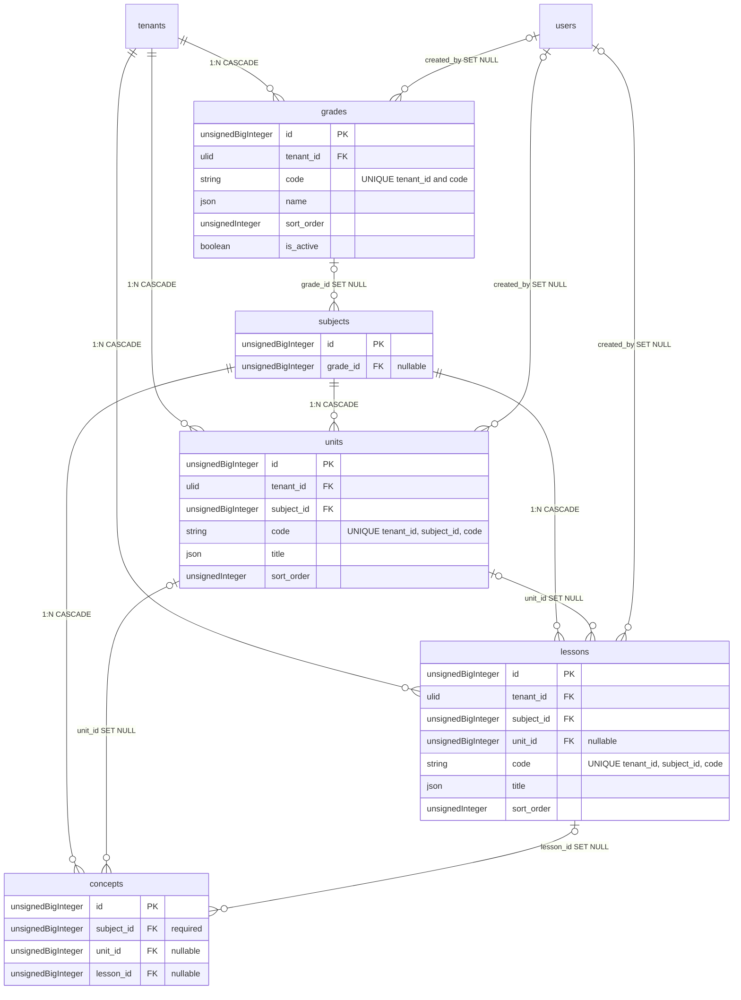

# FirOb — الهيكل الأكاديمي القابل للتهيئة لكل مؤسسة (Academic Structure)
## إضافة على system_analysis v3.4 + مخطط قاعدة البيانات (المرحلة 1 و2) + هيكلة الواجهات

> هذه الوثيقة هي المرجع الوحيد لهذه الميزة. الملفات الأخرى (`CLAUDE.md`, `ROADMAP_*`, `system_analysis.md`) تشير إليها وتلخّصها.
> ملفات PDF (هيكل قاعدة البيانات، العلاقات، ERD) و`هيكلة_الواجهات.md` غير قابلة للتعديل المباشر بشكل موثوق، لذلك تُعتبر **الأقسام 4–9 أدناه ملحقًا رسميًا** لها حتى يُعاد توليدها.

---

## 1. القرارات المعتمدة

1. كل مؤسسة (Tenant) تختار وتحدد هيكلها الأكاديمي بما يناسب وضعها.
2. **المقرر (Subject) إلزامي دائمًا.** أما **الصف (Grade) والوحدة (Unit) والدرس (Lesson)** فمستويات **اختيارية** تُفعَّل أو تُعطَّل من إعدادات المؤسسة.
3. **المفهوم (Concept) ينتمي إلى مقرر إلزاميًا.** ارتباطه بالصف/الوحدة/الدرس يتبع إعدادات المؤسسة.

## 2. النموذج المعتمد

```
Grade (اختياري) ──< Subject (إلزامي) ──< Unit (اختياري) ──< Lesson (اختياري) ──< Concept
                         │                                          │
                         └──────────── Concept.subject_id (إلزامي) ─┘
```

قواعد البنية:
- **الصف** خاصية على المقرر: `subjects.grade_id` (اختياري). صف المفهوم **يُشتق** من مقرره ولا يُخزَّن في `concepts` (مصدر وحيد للحقيقة، لا تعارض ممكن).
- **الوحدة** تتبع مقررًا دائمًا: `units.subject_id`.
- **الدرس** يتبع مقررًا دائمًا `lessons.subject_id`، ويتبع وحدة `lessons.unit_id` (اختياري) — فيمكن للمؤسسة تفعيل الدروس بدون وحدات.
- **المفهوم** يحمل `subject_id` (إلزامي) و`unit_id` و`lesson_id` (اختياريان).
- مادة تُدرَّس في عدة صفوف: تُنشأ كمقرر مستقل لكل صف (مثل «رياضيات - السابع»). راجع القرار المفتوح (أ).

## 3. إعدادات الهيكل (`tenant_settings`)

المفتاح: `academic.structure` (يستخدم `TenantSettingsService` الحالي، Cache-Aside عبر Redis مع إبطال فوري، ويخضع لقيد `UNIQUE(tenant_id, key)`).

```json
{
  "grades":  { "enabled": false, "required": false, "label": { "ar": "الصف",   "en": "Grade"  } },
  "units":   { "enabled": false, "required": false, "label": { "ar": "الوحدة", "en": "Unit"   } },
  "lessons": { "enabled": false, "required": false, "label": { "ar": "الدرس",  "en": "Lesson" } }
}
```

- **القيمة الافتراضية** عند غياب المفتاح: كل المستويات معطّلة (مقررات ومفاهيم فقط).
- `enabled`: يظهر المستوى في الواجهات ويُقبل في الإدخال.
- `required`: يُلزم الإدخال. `grades.required` يُلزم `subjects.grade_id`؛ `units.required` يُلزم `concepts.unit_id`؛ `lessons.required` يُلزم `concepts.lesson_id`. وإذا كانت `units.enabled && units.required` يُلزم أيضًا `lessons.unit_id`.
- `label`: تسمية مخصّصة بالعربية والإنجليزية (مثل «الفصل» أو «الباب» بدل «الوحدة»)، 1–50 حرفًا. **كل نص في الواجهة يستخدم التسمية من الإعدادات** وليس مفتاح ترجمة ثابتًا.
- قيد التحقق (`UpdateAcademicStructureSettingsRequest`): `required ⇒ enabled`، والتسميتان إلزاميتان، والمفاتيح غير المعروفة مرفوضة.
- **سلوك التغيير:**
  - تعطيل مستوى: يُخفى من الواجهات ويتوقف التحقق منه، **ولا تُحذف أو تُعدَّل أي بيانات موجودة**، وتبقى الصفوف/الوحدات/الدروس محفوظة لإعادة التفعيل.
  - جعل مستوى إلزاميًا: لا يكسر البيانات القديمة؛ يُفرض عند إنشاء/تعديل المفهوم وعند `SubmitForReviewAction` (الإرسال للمراجعة). المفاهيم القديمة غير المكتملة تظهر بشارة «تصنيف ناقص» ولا يمكن إرسالها للمراجعة قبل استكمالها.
- كائن القراءة: `AcademicStructureConfig` (DTO غير قابل للتعديل `readonly`) تُرجعه `AcademicStructureService::config()` — هو المصدر الوحيد الذي تقرأ منه الـ Form Requests والـ Policies والـ Livewire.
- **قوالب جاهزة (Presets)** في معالج التسجيل وشاشة الإعدادات: «مقررات فقط» · «صفوف + مقررات» · «مقررات + وحدات + دروس» · «هيكل كامل» · «مخصص».

### مصفوفة التحقق عند إنشاء/تعديل المفهوم

| الحقل | القاعدة |
|---|---|
| `subject_id` | إلزامي دائمًا، موجود داخل المستأجر الحالي (`Rule::exists(...)->where('tenant_id', app('currentTenantId'))`) |
| `unit_id` | مرفوض/متجاهَل إن كانت الوحدات معطّلة؛ إلزامي إن كانت `required`؛ يجب أن تتبع نفس `subject_id` |
| `lesson_id` | مثل الوحدة؛ يجب أن يتبع نفس `subject_id`؛ إن كان للدرس `unit_id` فيجب أن يساوي `concept.unit_id` (يُملأ تلقائيًا إن كان فارغًا) |
| صف المقرر | إن كانت `grades.required` فيجب أن يكون لـ `subject.grade_id` قيمة قبل إرسال أي مفهوم للمراجعة |

> مستوى معطّل = لا يُعرض ولا يُتحقق منه ولا يُعدَّل (لا يُصفَّر عند حفظ المفهوم).

---

## 4. تغييرات قاعدة البيانات (ملحق الخطوة 1 — الوحدة 5)

> بما أن النظام يُبنى من الصفر، تُدمج الأعمدة الجديدة في ملفات الإنشاء نفسها بدل ملفات تعديل (ALTER).

### grades (جديد)
| الحقل | النوع | القيود |
|---|---|---|
| id | uBigInt | PK |
| tenant_id | ulid | FK, CASCADE |
| code | string(50) | NOT NULL |
| name | json | NOT NULL (ترجمة) |
| description | json | Nullable |
| sort_order | unsignedInteger | Default 0 |
| is_active | boolean | Default true |
| created_by | uBigInt | FK → users.id, Nullable, SET NULL |
| timestamps, deleted_at | ts | Nullable (SD) |
| | | Unique (tenant_id, code) · Index (tenant_id, is_active, sort_order) |

### units (جديد)
| الحقل | النوع | القيود |
|---|---|---|
| id | uBigInt | PK |
| tenant_id | ulid | FK, CASCADE |
| subject_id | uBigInt | FK → subjects.id, CASCADE |
| code | string(50) | NOT NULL |
| title | json | NOT NULL (ترجمة) |
| description | json | Nullable |
| sort_order | unsignedInteger | Default 0 |
| is_active | boolean | Default true |
| created_by | uBigInt | FK → users.id, Nullable, SET NULL |
| timestamps, deleted_at | ts | Nullable (SD) |
| | | Unique (tenant_id, subject_id, code) · Index (tenant_id, subject_id, sort_order) |

### lessons (جديد)
| الحقل | النوع | القيود |
|---|---|---|
| id | uBigInt | PK |
| tenant_id | ulid | FK, CASCADE |
| subject_id | uBigInt | FK → subjects.id, CASCADE |
| unit_id | uBigInt | FK → units.id, Nullable, SET NULL |
| code | string(50) | NOT NULL |
| title | json | NOT NULL (ترجمة) |
| description | json | Nullable |
| sort_order | unsignedInteger | Default 0 |
| is_active | boolean | Default true |
| created_by | uBigInt | FK → users.id, Nullable, SET NULL |
| timestamps, deleted_at | ts | Nullable (SD) |
| | | Unique (tenant_id, subject_id, code) · Index (tenant_id, subject_id, unit_id, sort_order) |

### subjects (تعديل): إضافة
| الحقل | النوع | القيود |
|---|---|---|
| grade_id | uBigInt | FK → grades.id, Nullable, SET NULL · Index (tenant_id, grade_id) |

### concepts (تعديل): إضافة
| الحقل | النوع | القيود |
|---|---|---|
| unit_id | uBigInt | FK → units.id, Nullable, SET NULL |
| lesson_id | uBigInt | FK → lessons.id, Nullable, SET NULL |
| | | Index (tenant_id, subject_id, unit_id, lesson_id, sort_order) |

(`concepts.subject_id` يبقى `NOT NULL`، `CASCADE` كما هو.)

### ترتيب ملفات الترحيل (تعديل البند 5)
قبل: `subjects → concepts → learning_objects`
بعد: **`grades → subjects (+grade_id) → units → lessons → concepts (+unit_id, lesson_id) → learning_objects`**

## 5. العلاقات وقواعد الحذف (ملحق المرحلة 2 — الوحدة 5)

```
tenants (1) → grades (N)   · grades.tenant_id  · DELETE: CASCADE
users   (1) → grades (N)   · grades.created_by · Nullable · DELETE: SET NULL
tenants (1) → units (N)    · units.tenant_id   · DELETE: CASCADE
subjects(1) → units (N)    · units.subject_id  · DELETE: CASCADE
users   (1) → units (N)    · units.created_by  · Nullable · DELETE: SET NULL
tenants (1) → lessons (N)  · lessons.tenant_id · DELETE: CASCADE
subjects(1) → lessons (N)  · lessons.subject_id· DELETE: CASCADE
units   (1) → lessons (N)  · lessons.unit_id   · Nullable · DELETE: SET NULL
users   (1) → lessons (N)  · lessons.created_by· Nullable · DELETE: SET NULL
grades  (1) → subjects (N) · subjects.grade_id · Nullable · DELETE: SET NULL
units   (1) → concepts (N) · concepts.unit_id  · Nullable · DELETE: SET NULL
lessons (1) → concepts (N) · concepts.lesson_id· Nullable · DELETE: SET NULL
```

مبدأ الحذف: **حذف عنصر هيكلي (صف/وحدة/درس) لا يحذف المحتوى أبدًا.** المحتوى (المفاهيم) يُحذف فقط بحذف مقرره.

- الجداول الثلاثة تستخدم **SoftDeletes**؛ لذلك `ON DELETE` لا تُنفَّذ إلا عند `forceDelete`. والحماية الفعلية في `StructureDeletionGuard` (Service):
  - لا يُحذف صف له مقررات، ولا وحدة لها دروس أو مفاهيم، ولا درس له مفاهيم، **إلا بعد نقلها** (`reassign`) إلى عنصر آخر أو إلى «بلا تصنيف» إن كان المستوى غير إلزامي.
  - حذف مقرر (ناعم) يحذف ناعميًا وحداته ودروسه عبر Observer/Service (كما هو الحال مع مفاهيمه الآن).
- **سلامة العزل بين المستأجرين:** كل FK بين جدولين مملوكين لمستأجر يشترط تطابق `tenant_id` (Form Request: `Rule::exists(...)->where('tenant_id', ...)`). وهذا يشمل `grade_id` و`unit_id` و`lesson_id`. الـ FK المركّب `(tenant_id, parent_id)` غير مستخدم مع `SET NULL` لأنه سيصفّر `tenant_id` (NOT NULL) — يُكتفى بالتحقق في Form Request وService.
- **العلاقات غير المفروضة في القاعدة** (تتحقق منها الـ Service): تبعية الدرس لنفس مقرر الوحدة، وتبعية وحدة/درس المفهوم لنفس مقرره.

### الفهارس والقيود الفريدة (إضافة إلى البند 5)
- `grades`: UNIQUE(tenant_id, code) · (tenant_id, is_active, sort_order)
- `units`: UNIQUE(tenant_id, subject_id, code) · (tenant_id, subject_id, sort_order)
- `lessons`: UNIQUE(tenant_id, subject_id, code) · (tenant_id, subject_id, unit_id, sort_order)
- `subjects`: (tenant_id, grade_id)
- `concepts`: (tenant_id, subject_id, unit_id, lesson_id, sort_order) بالإضافة إلى الفهرس الحالي (tenant_id, subject_id, status)

## 6. ملحق ERD (Mermaid) — يُضاف إلى مخطط «المحتوى الأكاديمي»



---

## 7. الطبقات البرمجية (وفق دورة التنفيذ الإلزامية)

`Migration/Model → Interface & Repository → Service/Actions → Enums → Policies → Livewire → Tests`

- **Models** (`BelongsToTenant` + `SoftDeletes` + `HasTranslations`): `Grade`, `Unit`, `Lesson`. علاقات: `Grade::subjects()`، `Subject::grade()/units()/lessons()/concepts()`، `Unit::subject()/lessons()/concepts()`، `Lesson::subject()/unit()/concepts()`، `Concept::unit()/lesson()` و`Concept::grade()` كـ accessor مشتق من المقرر.
- **Repositories** (استعلامات فقط): `GradeRepository`, `UnitRepository`, `LessonRepository` (+ توسيع `SubjectRepository` و`ConceptRepository` بالفلاتر والـ eager loading).
- **Services/Actions:**
  - `AcademicStructureService`: `config()` (يقرأ عبر `TenantSettingsService`)، `update(array $settings)` (يدقق ويُبطل الكاش ويسجّل في Activity Log).
  - `GradeService`, `UnitService`, `LessonService`: CRUD + `reorder(array $ids)` + `reassign()`.
  - `StructureDeletionGuard`: يمنع حذف عنصر مستخدم (انظر القسم 5).
  - `ConceptClassificationValidator`: يطبق مصفوفة القسم 3؛ يستدعيه `StoreConceptRequest` و`UpdateConceptRequest` و`SubmitForReviewAction` و`StoreSubjectRequest` (لشرط `grades.required`).
- **Form Requests:** `UpdateAcademicStructureSettingsRequest`, `Store/UpdateGradeRequest`, `Store/UpdateUnitRequest`, `Store/UpdateLessonRequest`. كلها: `authorize()` يتحقق من سياق المستأجر، رسائل عربية/إنجليزية، وإضافة الحقول في `lang/ar/validation.php` (`attributes`).
- **Policies:** `GradePolicy`, `UnitPolicy`, `LessonPolicy` (انظر القسم 8).
- **Queue/Audit:** تغييرات الإعدادات والحذف وإعادة التعيين تُسجَّل في `activity_log` مع التقاط `tenant_id` و`causer_id` وقت الإرسال.
- **Cache:** `AcademicStructureConfig` يُخزَّن عبر `TenantSettingsService`؛ قوائم الصفوف/الوحدات/الدروس غير مخزنة مؤقتًا إلا إن ثبت الاحتياج.
- **Lang:** مفاتيح `lang/{ar,en}/messages.php` للنصوص الثابتة؛ أما أسماء المستويات المعروضة فتأتي من `label` في الإعدادات.

## 8. الصلاحيات (RBAC — تُضاف إلى `RoleMatrixEditor`)

| الصلاحية | Tenant Admin | Content Reviewer | Teacher/Editor | Student |
|---|---|---|---|---|
| `configure-academic-structure` (الإعدادات + الصفوف) | ✔ | ✖ | ✖ | ✖ |
| `manage-academic-structure` (الوحدات والدروس) | ✔ | ✖ | ✔ | ✖ |
| `view-academic-structure` (عرض) | ✔ | ✔ | ✔ | ✔ (النشط فقط) |

التحقق في Policy/Service دائمًا؛ إخفاء الأزرار UX فقط. إضافة الصلاحيات الجديدة تتطلب `forgetCachedPermissions()` فورًا.

## 9. الواجهات (ملحق «هيكلة الواجهات»)

| المعرّف | الشاشة | الجداول | الأولوية |
|---|---|---|---|
| ADM-05 (تعديل) | `TenantSettingsForm`: تبويب جديد **«الهيكل الأكاديمي»** — مفاتيح تفعيل/إلزام لكل مستوى + تسمية AR/EN + قوالب جاهزة + معاينة حية للشجرة | `tenant_settings` | P1 |
| ADM-09 (جديد) | شاشة الصفوف (تظهر في القائمة فقط إن كان الصف مفعّلًا): جدول + Slide-over + ترتيب بالسحب + حذف مع إعادة تعيين | `grades`, `subjects` | P1 |
| CNT-01 (تعديل) | قائمة المواد: عمود/فلتر الصف (إن فُعّل)، وحقل الصف في نموذج المادة (إلزامي حسب الإعداد) | `subjects`, `grades` | P1 |
| CNT-02 (تعديل) | تفاصيل المادة: تبويبات **«الوحدات»** و**«الدروس»** حسب الإعدادات (جدول + Slide-over + ترتيب) | `subjects`, `units`, `lessons` | P1 |
| CNT-03 (تعديل) | قائمة المفاهيم: فلاتر مقرر/وحدة/درس، وشارة «تصنيف ناقص» | `concepts` | P1 |
| CNT-04 (تعديل) | محرر المفهوم: قوائم متسلسلة **مقرر (إلزامي) ← وحدة ← درس** تظهر حسب الإعدادات، وتُفرَّغ التابعة عند تغيير الأب | `concepts`, `units`, `lessons` | P0 |
| AUTH-07 (تعديل) | `TenantOnboardingWizard`: خطوة «اختر هيكلك الأكاديمي» بقوالب جاهزة (قابلة للتخطي = «مقررات فقط») | `tenant_settings` | P1 |
| STU-02 (تعديل) | تصفح المواد: تنقّل هرمي صف ← مقرر ← وحدة ← درس ← مفاهيم، يعرض المستويات المفعّلة فقط، وللمنشور فقط | `concepts` | P3 |
| PUB-01 (تعديل) | الكتالوج العام: تجميع اختياري حسب الصف/المقرر | `learning_objects` | P4 |

- الشريط الجانبي (Tenant Admin): تحت «المحتوى» يضاف **«الهيكل الأكاديمي»** (الصفوف إن فُعّلت + الإعدادات).
- الحالات الستة لكل شاشة جديدة (Default/Empty/Loading/Validation/Forbidden/Quota) وفق قسم 3.4 في هيكلة الواجهات، والألوان من الـ Tokens الحالية دون ألوان جديدة. `Empty State` لشاشة بلا مستويات مفعّلة: «مؤسستك تعمل بالمقررات فقط — فعّل الصفوف أو الوحدات أو الدروس من الإعدادات».
- ترتيب البناء: يدخل ضمن موجة المحتوى (Sprint 4) بعد `TenantSettingsForm` الذي يُبنى في Sprint 3.

## 10. الاختبارات (Feature & Security) المطلوبة قبل إغلاق الوحدة

1. **عزل المستأجرين (IDOR):** رفض `grade_id`/`unit_id`/`lesson_id`/`subject_id` من مستأجر آخر في الإنشاء والتعديل والترتيب وإعادة التعيين.
2. **تماسك الشجرة:** رفض درس من مقرر آخر، ووحدة لا تتبع مقرر المفهوم، وتعارض `lesson.unit_id` مع `concept.unit_id`.
3. **الإلزام:** كل حالة من (grades/units/lessons) × (disabled/optional/required) على المقرر والمفهوم و`SubmitForReviewAction`.
4. **المستوى المعطّل:** لا يُتحقق منه، ولا تُصفَّر بياناته عند حفظ المفهوم، وتبقى محفوظة عند التعطيل ثم إعادة التفعيل.
5. **الإعدادات:** رفض `required` بدون `enabled`، ومفاتيح مجهولة، وتسمية فارغة؛ وإبطال الكاش فورًا؛ وصلاحية `configure-academic-structure`.
6. **الحذف:** `StructureDeletionGuard` (منع حذف عنصر مستخدم، `reassign` ثم الحذف، عدم حذف مفاهيم أبدًا).
7. **الأداء:** قائمة المفاهيم والتصفح الهرمي دون N+1 (eager loading)، وعدد الاستعلامات ثابت.
8. **الصلاحيات:** مصفوفة القسم 8 لكل دور، واختبار تصعيد أفقي/رأسي.

## 11. الأثر على بقية الوحدات

- **الاختبارات (Quizzes):** بلا تغيير الآن (`subject_id` إلزامي و`concept_id` اختياري). راجع القرار المفتوح (ب).
- **كائنات التعلّم والوسائط والذكاء الاصطناعي:** بلا تغيير؛ تصنيفها يأتي عبر المفهوم. مسارات R2 كما هي (`tenants/{tenant_id}/concepts/...`).
- **الحصص (Quotas):** لا حدّ جديد في `plans`.
- **نشر المحتوى:** يضاف شرط التصنيف الإلزامي إلى `SubmitForReviewAction` فقط.

## 12. قرارات مفتوحة (تحتاج قرارك قبل التنفيذ)

- **(أ) الصف مع المقرر:** اعتمدتُ علاقة 1:N (مقرر ينتمي لصف واحد) لأنها الأبسط وتمنع التعارض. إن أردت مقررًا واحدًا يمتد على عدة صفوف، نحوّلها إلى N:M (جدول `grade_subject`) ويصبح صف المفهوم عمودًا صريحًا.
- **(ب) الاختبارات:** هل تريد ربط `quizzes` أيضًا بالوحدة/الدرس (اختياريًا بنفس الإعدادات)؟ حاليًا يرتبط بالمقرر والمفهوم فقط.
- **(ج) الدرس بدون وحدة:** مسموح عندما تكون الوحدات معطّلة أو غير إلزامية. هل تريد منعه كلما فُعّلت الوحدات؟
- **(د) مستويات إضافية:** النموذج ثابت بثلاثة مستويات اختيارية فوق المقرر/تحته. إن احتجت مستويات مخصصة بالكامل (مثل «فصل دراسي» أو «مسار») فالمدخل الأنسب شجرة عامة (`academic_nodes`) وهي أعقد؛ أوصي بتأجيلها.

## 13. معايير القبول

- مؤسسة بإعدادات افتراضية تعمل بالمقررات والمفاهيم كما كان قبل الميزة بلا أي تغيير في الواجهة.
- تفعيل أي مستوى يُظهر شاشاته وحقوله فورًا، وتعطيله يخفيها دون فقدان بيانات.
- لا يمكن حفظ تصنيف يخالف الإعدادات أو يتجاوز حدود المستأجر، ولو بتعديل الطلب يدويًا.
- جميع الاختبارات في القسم 10 تمر، ولا استعلامات N+1 على شاشات القوائم.
